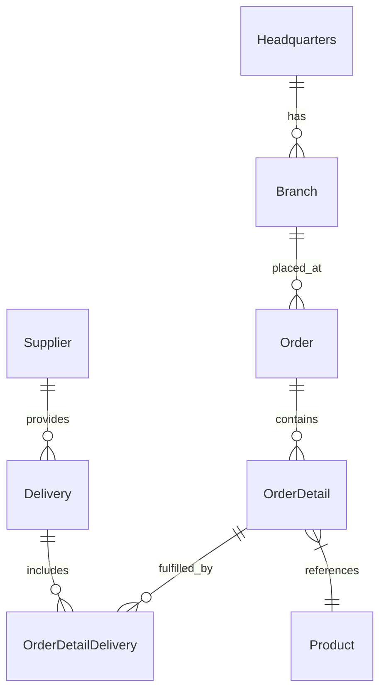

# OctoCAT Supply · PGGM Innovation Day

This repo has two parts: [labs/](./labs/) contains the hands-on exercises; everything else is the OctoCAT Supply app you'll work on.

## Start here

[](https://codespaces.new/shireendan/octocat-supply/tree/workshop?quickstart=1)

1. Sign in with the GitHub account that has your Copilot license, then open the link above.
2. The link creates your codespace the first time and resumes it on later visits.
3. Wait for setup (`make install && make build`) to finish, then open the [labs index](./labs/README.md).

## Supported environments

- **GitHub Codespaces (recommended):** use the link above.
- **This repo's dev container on your own machine:** use VS Code, Docker and the Dev Containers extension. Open the repo in VS Code and choose **Reopen in Container**.

Only these environments are supported on the day. The Ubuntu-based container provides Node.js 24/npm, Python, the Azure and GitHub CLIs, and VS Code extensions including Copilot. It installs dependencies, builds the app and forwards **3000** (API) and **5137** (website).

## Branches

- **`workshop`:** where you work during the labs.
- **`main`:** the complete app and reference solution you'll compare with. Never commit to `main`.

## What's where

| Folder | Contents |
|---|---|
| [labs/](./labs/) | Hands-on workshop exercises |
| [api/](./api/) | Express REST API and SQLite database |
| [frontend/](./frontend/) | React website |
| [docs/](./docs/) | Architecture, database, build and deployment guides |
| [infra/](./infra/) | Infrastructure and deployment scripts |
| [demo/](./demo/) | walkthroughs from the original sample |
| [.github/](./.github/) | Copilot and GitHub configuration |
| [.devcontainer/](./.devcontainer/) | Shared Codespaces and dev container setup |
| [.vscode/](./.vscode/) | VS Code tasks, debug and workspace configuration |

## The app


OctoCAT Supply is a sample supply chain management app for managing products, suppliers, branches, orders and deliveries. Its React website uses an Express API backed by SQLite, with Swagger documentation for exploring the API.



**Tech stack**

- **Frontend:** React 18, TypeScript, Tailwind CSS and Vite.
- **Backend:** Express.js, TypeScript and OpenAPI/Swagger.
- **Data:** SQLite; file-backed for the app and in-memory for tests.
- **DevOps:** Docker.

## Run the app

Run commands from the repo root in your codespace or dev container:

```bash
make dev
```

In a codespace, open the **Ports** tab and open the forwarded ports:
- **3000:** API; add `/api-docs` to the forwarded URL for Swagger.
- **5137:** website.

Stop the servers with **Ctrl+C**.

| Command | Purpose |
|---|---|
| `make dev` | Start the API and website |
| `make dev-api` | Start only the API |
| `make dev-frontend` | Start only the website |
| `make test` | Start the API test watcher; press **q** to quit; see the limitation below |
| `make help` | List available Make targets |
| `make install` | Install dependencies (already done during setup) |
| `make build` | Build the API and website |
| `make db-init` | Apply pending database migrations |
| `make db-seed` | Apply migrations and seed sample data |
| `make clean` | Remove build outputs, dependencies and database files at the API folder root |

`make test` is not a working full-suite command: after the API tests, it calls a frontend `test` script that is not defined.

**Database commands**

npm equivalents (migrations, then sample data):
```bash
cd api
npm run db:migrate
npm run db:seed
cd ..
```

The default database is `api/data/app.db` (override with `DB_FILE`). WAL mode and foreign keys default to enabled (`DB_ENABLE_WAL` and `DB_FOREIGN_KEYS`).

**VS Code tasks**

Use **Tasks: Run Task** in the Command Palette, then **Build All**, **Build API** or **Build Frontend**. The **Start API & Frontend** debug configuration calls a root npm script that is not defined; use `make dev` instead.

## Docs

- [Architecture](./docs/architecture.md)
- [SQLite integration](./docs/sqlite-integration.md)
- [Build and test guide](./docs/build.md)
- [Deployment](./docs/deployment.md)

## Credits

Based on [OctoCAT Supply (Azure-Samples)](https://github.com/Azure-Samples/octocat-supply), version **v3.7.0** of the sample.
