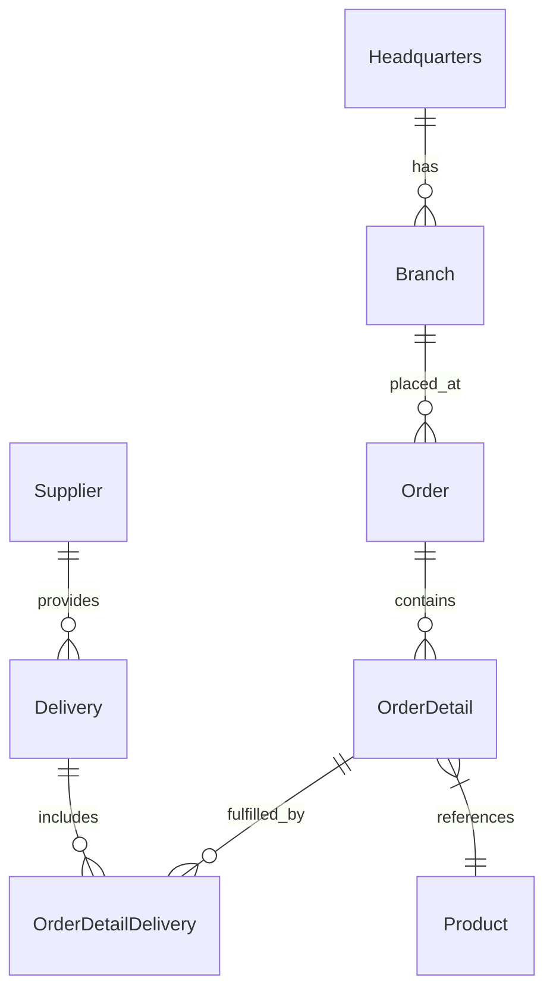

# Welcome to PGGM Innovation Day

**From an unfamiliar codebase to a working feature, with GitHub Copilot.**

New team. New repository. Your first feature request. It's a familiar engineering challenge: before you can build anything, you need to understand the application, find the right files and learn the team's conventions. Today, we'll work through that journey together, with an AI teammate.

This repo is your hands-on playground for the **Foundation Track**. We'll move from asking Copilot questions to working with agents that can plan, edit files and run tools. Along the way, you'll learn how to give them useful context and clear boundaries, while keeping the engineering decisions in your hands.

Whether you work on frontends, APIs, data or platforms, you're welcome here. You don't need to know this codebase or be a TypeScript expert: your job is to **describe, review and verify**. Where possible, pair up with someone from a different role and compare perspectives.

Our shared application is **OctoCAT Supply**, a sample supply-chain app, not a PGGM production system. [labs/](./labs/) contains the guided exercises; everything else is the application we'll explore and extend throughout the day.

## Start here

[](https://codespaces.new/shireendan/octocat-supply/tree/workshop?quickstart=1)

1. Sign in with the GitHub account that has your Copilot license, then open the link above.
2. The link creates your codespace the first time and resumes it on later visits.
3. Wait for setup (`make install && make build`) to finish, then open the [labs README](./labs/README.md) for the schedule and context on how the exercises work.
4. Follow the [setup guide](./labs/01-setup.md) for the remaining setup steps, app and Copilot checks, and troubleshooting before F1.

## Supported environments

- **GitHub Codespaces (recommended):** use the link above.
- **This repo's dev container on your own machine:** use VS Code, Docker and the Dev Containers extension. Open the repo in VS Code and choose **Reopen in Container**.

Only these environments are supported on the day. The Ubuntu-based container provides Node.js 24/npm, Python, the Azure and GitHub CLIs, and VS Code extensions including Copilot. It installs dependencies, builds the app and forwards **3000** (API) and **5137** (website).

## Branches

- **`workshop`:** where you work during the labs.
- **`main`:** the complete app and reference solution you'll compare with. Never commit to `main`.

## What we'll do together

Start with the overview and setup guide, then follow one application through four steps from getting oriented to agentic development:

| Guide or session | Purpose | What it covers |
|---|---|---|
| [Labs README](./labs/README.md) | Get the workshop context before you begin. | The schedule, how the labs work, lab conventions and where to get help. |
| [Setup guide](./labs/01-setup.md) | Complete setup before F1. | Step-by-step Codespaces setup, branch and app checks, Copilot checks, ground rules and troubleshooting. |
| [F1. Prompting Fundamentals](./labs/F1-prompting-fundamentals.md) | Understand an unfamiliar repo and tackle your first ticket: count orders by branch. | Clear prompts, code completion, and choosing between Ask, Agent and Plan. |
| [F2. Build Your Personal Agent](./labs/F2-build-your-personal-agent.md) | Give an AI teammate a focused role and clear boundaries. | A shared API Specialist and your own read-only review agent. |
| [F3. Context Engineering in Practice](./labs/F3-context-engineering.md) | Help Copilot follow the team's conventions instead of guessing. | Reusable repository instructions, project context and skills. |
| [F4. First Steps in Agentic Development](./labs/F4-mcp-and-spec-driven.md) | Take an orders-by-branch API feature from a specification to a working endpoint. | External documentation through Model Context Protocol (MCP), acceptance criteria, tests first and implementation. |

The goal isn't just to generate code. It's to practise a workflow you can take back to your PGGM team: **understand, plan, provide context, build, review and verify**. You decide what success looks like, review the agent's changes and check that the tests and running application back up its claims.

Follow the [labs index](./labs/README.md) for the schedule and step-by-step exercises. Different Copilot outputs are expected; bring your questions, compare approaches and check the results together.

## What's where

| Folder | Contents |
|---|---|
| [labs/](./labs/) | Hands-on workshop exercises |
| [api/](./api/) | Express REST API and SQLite database |
| [frontend/](./frontend/) | React website |
| [docs/](./docs/) | Architecture, database, build and deployment guides |
| [infra/](./infra/) | Infrastructure and deployment scripts |
| [demo/](./demo/) | walkthroughs from the original sample |
| [.github/](./.github/) | Copilot and GitHub configuration |
| [.devcontainer/](./.devcontainer/) | Shared Codespaces and dev container setup |
| [.vscode/](./.vscode/) | VS Code tasks, debug and workspace configuration |

## The app


OctoCAT Supply is a sample supply chain management app for managing products, suppliers, branches, orders and deliveries. Its React website uses an Express API backed by SQLite, with Swagger documentation for exploring the API.



**Tech stack**

- **Frontend:** React 18, TypeScript, Tailwind CSS and Vite.
- **Backend:** Express.js, TypeScript and OpenAPI/Swagger.
- **Data:** SQLite; file-backed for the app and in-memory for tests.
- **DevOps:** Docker.

## Run the app

Run commands from the repo root in your codespace or dev container:

```bash
make dev
```

In a codespace, open the **Ports** tab and open the forwarded ports:
- **3000:** API; add `/api-docs` to the forwarded URL for Swagger.
- **5137:** website.

Stop the servers with **Ctrl+C**.

| Command | Purpose |
|---|---|
| `make dev` | Start the API and website |
| `make dev-api` | Start only the API |
| `make dev-frontend` | Start only the website |
| `make test` | Start the API test watcher; press **q** to quit; see the limitation below |
| `make help` | List available Make targets |
| `make install` | Install dependencies (already done during setup) |
| `make build` | Build the API and website |
| `make db-init` | Apply pending database migrations |
| `make db-seed` | Apply migrations and seed sample data |
| `make clean` | Remove build outputs, dependencies and database files at the API folder root |

`make test` is not a working full-suite command: after the API tests, it calls a frontend `test` script that is not defined.

**Database commands**

npm equivalents (migrations, then sample data):
```bash
cd api
npm run db:migrate
npm run db:seed
cd ..
```

The default database is `api/data/app.db` (override with `DB_FILE`). WAL mode and foreign keys default to enabled (`DB_ENABLE_WAL` and `DB_FOREIGN_KEYS`).

**VS Code tasks**

Use **Tasks: Run Task** in the Command Palette, then **Build All**, **Build API** or **Build Frontend**. The **Start API & Frontend** debug configuration calls a root npm script that is not defined; use `make dev` instead.

## Docs

- [Architecture](./docs/architecture.md)
- [SQLite integration](./docs/sqlite-integration.md)
- [Build and test guide](./docs/build.md)
- [Deployment](./docs/deployment.md)

## Credits

Based on [OctoCAT Supply (Azure-Samples)](https://github.com/Azure-Samples/octocat-supply), version **v3.7.0** of the sample.
