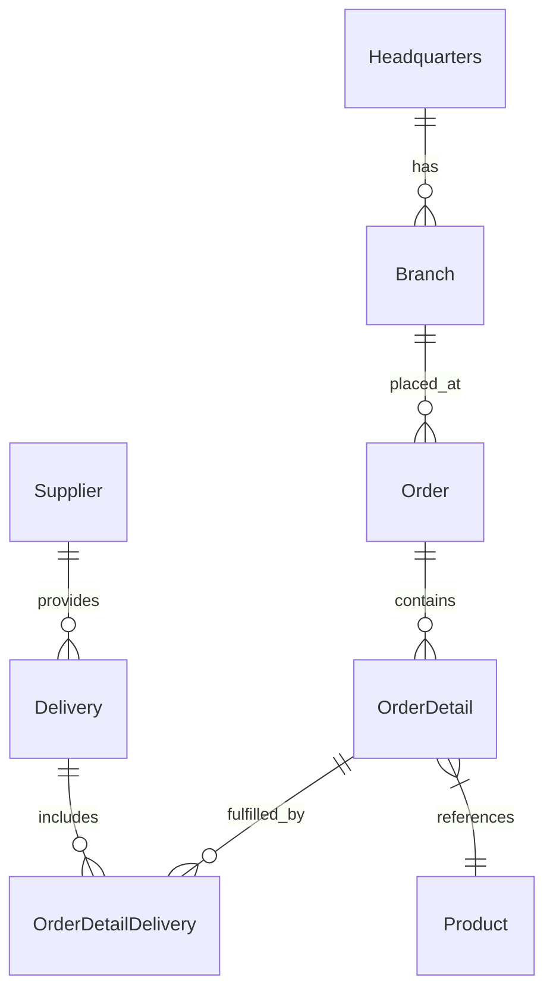

# Welcome to PGGM Innovation Day

**From an unfamiliar codebase to a working feature, with GitHub Copilot.**

New team. New repository. Your first feature request. It's a familiar engineering challenge: before you can build anything, you need to understand the application, find the right files and learn the team's conventions. Today, we'll work through that journey together, with an AI teammate.

This repo is your hands-on playground for the **Foundation Track**. We'll move from asking Copilot questions to working with agents that can plan, edit files and run tools. Along the way, you'll learn how to give them useful context and clear boundaries, while keeping the engineering decisions in your hands.

Whether you work on frontends, APIs, data or platforms, you're welcome here. You don't need to know this codebase or be a TypeScript expert: your job is to **describe, review and verify**. Where possible, pair up with someone from a different role and compare perspectives.

Our shared application is **OctoCAT Supply**, a sample supply-chain app, not a PGGM production system. [labs/](./labs/) contains the guided exercises; everything else is the application we'll explore and extend throughout the day.

## Start here

[](https://codespaces.new/shireendan/octocat-supply/tree/workshop?quickstart=1)

1. Sign in with the GitHub account that has your Copilot license and access to this repo.
2. Choose an environment below. **Codespaces is recommended, not mandatory.** The link above creates your codespace the first time and resumes it on later visits.
3. Follow the [setup guide](./labs/01-setup.md) for your chosen environment, including installation, branch, app and Copilot checks, and troubleshooting before F1.
4. Open the [labs README](./labs/README.md) for the schedule and context on how the exercises work.

## Environment options

- **GitHub Codespaces (recommended):** use the link above, then follow the [Codespaces setup](./labs/01-setup.md#option-a-github-codespaces-recommended). The tools, dependencies and build are prepared automatically.
- **Local Node.js and npm:** use VS Code, Git and Node.js **24.x** (npm included) on your own machine. Follow the [local Windows setup](./labs/01-setup.md#option-b-local-nodejs-and-npm-windows). No Docker or `make` is required.

Both options use the same app and labs, with **3000** for the API and **5137** for the website. Codespaces uses forwarded URLs; local users open `localhost`. The local instructions use Windows PowerShell and npm commands instead of the labs' `make` shortcuts.

Complete the app and Copilot checks before the training. Both options require repo access and a working Copilot license; local setup also needs permission to install tools and download packages. If installation or enterprise network restrictions prevent a working setup, contact IT or ask a facilitator about pairing with someone whose environment is ready.

## Branches

- **`workshop`:** where you work during the labs.
- **`main`:** the complete app and reference solution you'll compare with. Never commit to `main`.

## What we'll do together

Start with the overview and setup guide, then follow one application through four steps from getting oriented to agentic development:

| Guide or session | Purpose | What it covers |
|---|---|---|
| [Labs README](./labs/README.md) | Get the workshop context before you begin. | The schedule, how the labs work, lab conventions and where to get help. |
| [Setup guide](./labs/01-setup.md) | Complete setup before F1. | Codespaces or local setup, Windows command equivalents, branch and app checks, Copilot checks, ground rules and troubleshooting. |
| [F1. Prompting Fundamentals](./labs/F1-prompting-fundamentals.md) | Understand an unfamiliar repo and tackle your first ticket: count orders by branch. | Clear prompts, code completion, and choosing between Ask, Agent and Plan. |
| [F2. Build Your Personal Agent](./labs/F2-build-your-personal-agent.md) | Give an AI teammate a focused role and clear boundaries. | A shared API Specialist and your own read-only review agent. |
| [F3. Context Engineering in Practice](./labs/F3-context-engineering.md) | Help Copilot follow the team's conventions instead of guessing. | Reusable repository instructions, project context and skills. |
| [F4. First Steps in Agentic Development](./labs/F4-mcp-and-spec-driven.md) | Take an orders-by-branch API feature from a specification to a working endpoint. | External documentation through Model Context Protocol (MCP), acceptance criteria, tests first and implementation. |

The goal isn't just to generate code. It's to practise a workflow you can take back to your PGGM team: **understand, plan, provide context, build, review and verify**. You decide what success looks like, review the agent's changes and check that the tests and running application back up its claims.

Follow the [labs index](./labs/README.md) for the schedule and step-by-step exercises. Different Copilot outputs are expected; bring your questions, compare approaches and check the results together.

## What's where

| Folder | Contents |
|---|---|
| [labs/](./labs/) | Hands-on workshop exercises |
| [api/](./api/) | Express REST API and SQLite database |
| [frontend/](./frontend/) | React website |
| [docs/](./docs/) | Architecture, database, build and deployment guides |
| [infra/](./infra/) | Infrastructure and deployment scripts |
| [demo/](./demo/) | walkthroughs from the original sample |
| [.github/](./.github/) | Copilot and GitHub configuration |
| [.devcontainer/](./.devcontainer/) | Codespaces environment setup |
| [.vscode/](./.vscode/) | VS Code tasks, debug and workspace configuration |

## The app


OctoCAT Supply is a sample supply chain management app for managing products, suppliers, branches, orders and deliveries. Its React website uses an Express API backed by SQLite, with Swagger documentation for exploring the API.



**Tech stack**

- **Frontend:** React 18, TypeScript, Tailwind CSS and Vite.
- **Backend:** Express.js, TypeScript and OpenAPI/Swagger.
- **Data:** SQLite; file-backed for the app and in-memory for tests.
- **DevOps:** Docker.

## Run the app

### GitHub Codespaces

After automatic setup finishes, run this from the repo root in your codespace:

```bash
make dev
```

Open the **Ports** tab and open the forwarded ports:
- **3000:** API; add `/api-docs` to the forwarded URL for Swagger.
- **5137:** website.

### Local Node.js and npm (Windows)

Use **Node.js 24.x**, npm, Git and a normal local VS Code window. Follow the [local setup guide](./labs/01-setup.md#option-b-local-nodejs-and-npm-windows) to install tools and clone the `workshop` branch.

For the first setup, run these **one at a time** from the repo root in PowerShell. Stop and resolve any error before continuing:

```powershell
node --version
npm.cmd --version
npm.cmd --prefix .\api ci --include=optional
npm.cmd --prefix .\frontend ci --include=optional
npm.cmd --prefix .\api run build
npm.cmd --prefix .\frontend run build
```

`ci` cleanly reinstalls the locked dependencies, including the correct platform-specific packages, without changing your source files or lockfiles. `npm.cmd` avoids PowerShell's `npm.ps1` execution-policy issue.

Then open **two PowerShell terminals at the repo root**.

**Terminal 1 - API:**

```powershell
npm.cmd --prefix .\api run dev
```

**Terminal 2 - website:**

```powershell
npm.cmd --prefix .\frontend run dev
```

Open http://localhost:5137 for the website and http://localhost:3000/api-docs for Swagger. The API initializes and seeds SQLite automatically; no separate database server is needed. If Node.js or npm is not recognised, follow the [PowerShell PATH troubleshooting](./labs/01-setup.md#nodejs-installed-but-not-recognised-in-powershell).

Keep both terminals running while using the app. Stop the servers with **Ctrl+C** in each terminal. For later sessions, repeat only the two `run dev` commands; a clean install is not needed every time.

### Codespaces command reference

The following `make` shortcuts are for Codespaces. Local Windows users do not need Make; use the [PowerShell equivalents](./labs/01-setup.md#local-windows-equivalents-for-lab-commands).

| Command | Purpose |
|---|---|
| `make dev` | Start the API and website |
| `make dev-api` | Start only the API |
| `make dev-frontend` | Start only the website |
| `make test` | Start the API test watcher; press **q** to quit; see the limitation below |
| `make help` | List available Make targets |
| `make install` | Install dependencies (already done during setup) |
| `make build` | Build the API and website |
| `make db-init` | Apply pending database migrations |
| `make db-seed` | Apply migrations and seed sample data |
| `make clean` | Remove build outputs, dependencies and database files at the API folder root |

`make test` is not a working full-suite command: after the API tests, it calls a frontend `test` script that is not defined.

**Database commands (optional)**

API startup already applies migrations and seeds sample data. To run these manually after building the API:

In Codespaces:
```bash
npm --prefix api run db:migrate
npm --prefix api run db:seed
```

In local Windows PowerShell:
```powershell
npm.cmd --prefix .\api run db:migrate
npm.cmd --prefix .\api run db:seed
```

The default database is `api/data/app.db` (override with `DB_FILE`). WAL mode and foreign keys default to enabled (`DB_ENABLE_WAL` and `DB_FOREIGN_KEYS`).

**VS Code tasks**

Use **Tasks: Run Task** in the Command Palette, then **Build All**, **Build API** or **Build Frontend**. The **Start API & Frontend** debug configuration calls a root npm script that is not defined; use the development commands above for your environment instead.

## Docs

- [Architecture](./docs/architecture.md)
- [SQLite integration](./docs/sqlite-integration.md)
- [Build and test guide](./docs/build.md)
- [Deployment](./docs/deployment.md)

## Credits

Based on [OctoCAT Supply (Azure-Samples)](https://github.com/Azure-Samples/octocat-supply), version **v3.7.0** of the sample.
