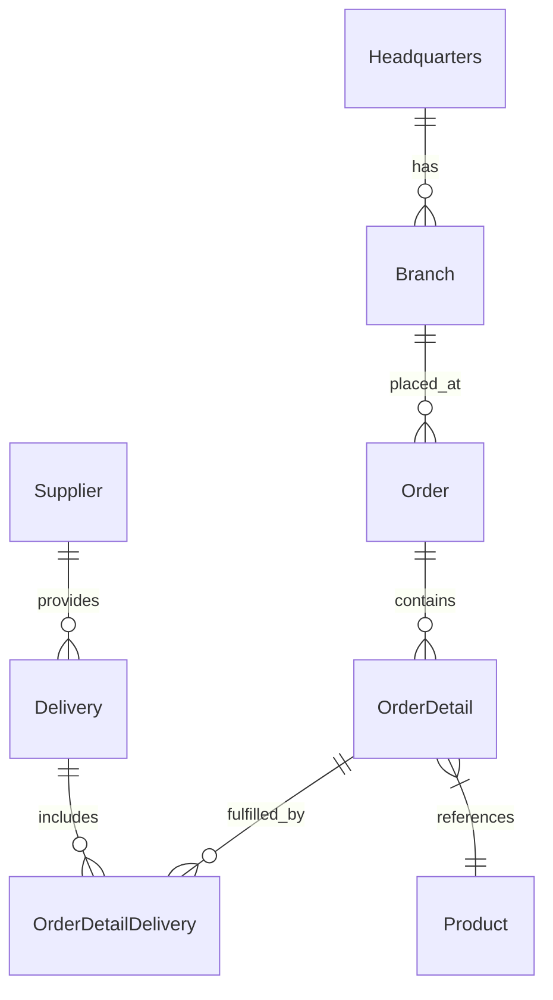

## The app


OctoCAT Supply is a sample supply chain management app for managing products, suppliers, branches, orders and deliveries. Its React website uses an Express API backed by SQLite, with Swagger documentation for exploring the API.



**Tech stack**

- **Frontend:** React 18, TypeScript, Tailwind CSS and Vite.
- **Backend:** Express.js, TypeScript and OpenAPI/Swagger.
- **Data:** SQLite; file-backed for the app and in-memory for tests.
- **DevOps:** Docker.

## Run the app

### Windows DevBox/local (primary option)

Use the latest **Node.js 24.x** release, npm, Git and VS Code on your Windows DevBox or laptop. Run the commands and open the browser on that same machine; `localhost` refers to it. Follow the [Windows setup guide](../labs/01-setup.md#option-a-local-nodejs-and-npm-windows), including [Node.js and Python installation](../labs/01-setup.md#install-nodejs-and-python), to prepare the tools and clone the `workshop` branch.

**Managed Windows machines:** before installing dependencies, follow the [enterprise certificate-trust guidance](../labs/troubleshooting.md#enterprise-certificate-trust) if your organisation requires company certificates or Node reports `unable to get local issuer certificate`. If the approved certificates are already trusted by Windows, run this in the same PowerShell terminal before the installation commands:

```powershell
$env:NODE_USE_SYSTEM_CA = "1"
```

This keeps HTTPS verification enabled and uses Windows' trusted certificates. It applies only to that terminal and its child processes; repeat in new terminals when needed. It is not required on every machine or for Codespaces. If it does not resolve the error, follow the certificate troubleshooting guidance above.

For the first setup, run these **one at a time** from the repo root in PowerShell. Stop and resolve any error before continuing:

```powershell
node --version
npm.cmd --version
npm.cmd --prefix .\app\api ci --include=optional
npm.cmd --prefix .\app\frontend ci --include=optional
npm.cmd --prefix .\app\api run build
npm.cmd --prefix .\app\frontend run build
```

`ci` cleanly reinstalls the locked dependencies, including the correct platform-specific packages, without changing your source files or lockfiles. `npm.cmd` avoids PowerShell's `npm.ps1` execution-policy issue.

Then open **two PowerShell terminals at the repo root**.

**Terminal 1 - API:**

```powershell
npm.cmd --prefix .\app\api run dev
```

**Terminal 2 - website:**

```powershell
npm.cmd --prefix .\app\frontend run dev
```

Open http://localhost:5137 for the website and http://localhost:3000/api-docs for Swagger. The API initializes and seeds SQLite automatically; no separate database server is needed. If Node.js or npm is not recognised, follow the [PowerShell PATH troubleshooting](../labs/troubleshooting.md#nodejs-installed-but-not-recognised-in-powershell).

Keep both terminals running while using the app. Stop the servers with **Ctrl+C** in each terminal. For later sessions, repeat only the two `run dev` commands; a clean install is not needed every time.

### GitHub Codespaces (second option)

Follow the [Codespaces setup](../labs/01-setup.md#option-b-github-codespaces) if you cannot prepare the native Windows environment. After automatic setup finishes, run this from the repo root in your codespace:

```bash
make -C app dev
```

Open the **Ports** tab and open the forwarded ports:
- **3000:** API; add `/api-docs` to the forwarded URL for Swagger.
- **5137:** website.

### Codespaces command reference

The following `make` shortcuts are for Codespaces. Local Windows users do not need Make; use the [PowerShell equivalents](../labs/troubleshooting.md#local-windows-equivalents-for-lab-commands).

| Command | Purpose |
|---|---|
| `make -C app dev` | Start the API and website |
| `make -C app dev-api` | Start only the API |
| `make -C app dev-frontend` | Start only the website |
| `make -C app test-api` | Run the API test suite in watch mode; press **q** to quit |
| `make -C app help` | List available Make targets |
| `make -C app install` | Install dependencies (already done during setup) |
| `make -C app build` | Build the API and website |
| `make -C app db-init` | Apply pending database migrations |
| `make -C app db-seed` | Apply migrations and seed sample data |
| `make -C app clean` | Remove build outputs, dependencies and database files at the API folder root |

**Database commands (optional)**

API startup already applies migrations and seeds sample data. To run these manually after building the API:

In local Windows PowerShell:
```powershell
npm.cmd --prefix .\app\api run db:migrate
npm.cmd --prefix .\app\api run db:seed
```

In Codespaces:
```bash
npm --prefix app/api run db:migrate
npm --prefix app/api run db:seed
```

The default database is `app/api/data/app.db` (override with `DB_FILE`). WAL mode and foreign keys default to enabled (`DB_ENABLE_WAL` and `DB_FOREIGN_KEYS`).

**VS Code tasks**

Use **Tasks: Run Task** in the Command Palette, then **Build All**, **Build API** or **Build Frontend**. These tasks use each project's npm build script on Windows and in Codespaces. The **Start API & Frontend** debug compound starts both projects from their respective application folders.

## Docs

- [Architecture](./docs/architecture.md)
- [SQLite integration](./docs/sqlite-integration.md)
- [Build and test guide](./docs/build.md)
- [Deployment](./docs/deployment.md)

## Credits

Based on [OctoCAT Supply (Azure-Samples)](https://github.com/Azure-Samples/octocat-supply), version **v3.7.0** of the sample.
